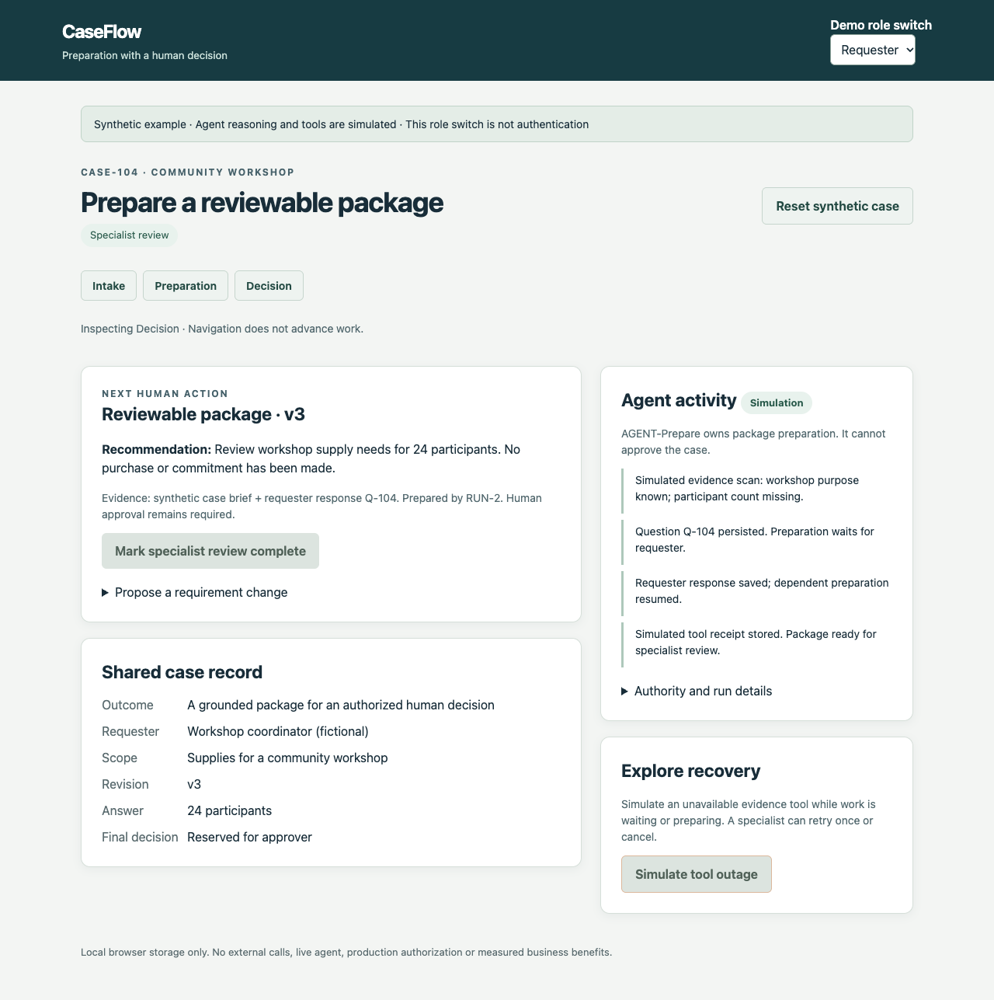

# DesignKit

**AI-assisted forward-deployed engineering for transforming manual business processes into AI-native agent operating models.**

Start with business outcomes, current work, decisions and exceptions. Eliminate,
combine and simplify work before assigning coherent outcomes to agents. Define
what agents know, which tools they may use, what state they preserve, when they
finish and when a person must intervene. Deterministic tasks and human judgment
remain explicit.

Version 0.1.0 provides a local CLI, seven portable capability guides, Codex and
Claude skill scaffolds, artifact gates, versioned exports, a conservative Spec Kit
bridge and a runnable synthetic CaseFlow example. It is an authoring toolkit,
not a production agent runtime. [Compatibility and limits](docs/compatibility.md).



## Quickstart

Python 3.11+ required (tested locally with 3.12.7). Install from this repository;
no PyPI publication is claimed.

```sh
git clone https://github.com/smittysoup/designkit.git
cd designkit
python3 -m venv .venv
# macOS/Linux; on Windows use .venv\Scripts\activate
. .venv/bin/activate
python -m pip install .
designkit init --root '../my project' --initiative intake \
  --process 'Manual case preparation' --outcome 'Reduce rework while retaining human judgment' \
  --adapter codex
designkit guide discover --root '../my project' --initiative intake
designkit status --root '../my project' --initiative intake
```

`init` creates `design/intake/` drafts and project-local instructions. It never
replaces an existing initiative or AGENTS.md. `status` reports gaps without failing;
`check` exits 2 for `not_ready`, 1 for invalid inputs, 0 for ready. Fresh drafts
should not pass. Existing `.specify/` files remain intact.

In Codex, invoke `$designkit-discover` and identify `design/intake/`; in Claude,
initialize with `--adapter claude` then invoke `/designkit-discover`. Both generated
formats are fixture-tested; live native execution is not claimed. With any other
authoring assistant, supply the output of `designkit guide` and the selected
initiative's files. The assistant helps author artifacts; business agents are the
systems being designed and have separately bounded authority.

## Work iteratively

| Capability | Learn or produce |
|---|---|
| Discover | Current work, baseline, exceptions, outcome and authority |
| Envision | Work eliminated/combined/simplified; agent and human responsibilities |
| Prototype | Question → authorized answer → resumed work → reviewable outcome |
| Validate | Business and agent evaluations, observations and owned gaps |
| Model | Mandatory data-model.md, entity/data-flow/process diagrams and state |
| Contract | Bounded operations, payloads, errors, versions and recovery |
| Handoff | Scoped snapshot, provenance, readiness and downstream reconciliation |

Start from an existing prototype if useful: first identify the process and
outcome it transforms, then fill the missing authority, baseline and evaluation
records. Resume a fresh session by reading manifest, decisions, questions and the
relevant guide. Do not create an agent for every manual task or phase. If no useful
agentic redesign exists, record that finding.

The BRD owns FR/NFR meaning. The manifest and traceability index link stable IDs
without replacing it. [Authoring and gates](docs/authoring.md) explains hashes,
reviews, new artifacts and partial work. [Roles](docs/roles.md) assigns judgment.

## Run CaseFlow

```sh
python -m http.server 4173 --directory examples/caseflow/design/caseflow/experience/prototype
```

Open `http://localhost:4173`. Answer as Requester, run simulated preparation, review
as Specialist, then decide as Approver. Try a revised requirement or a tool outage.
Phase inspection does not advance work. Reset starts a new synthetic case.
[Walkthrough and evidence](examples/caseflow/design/caseflow/validation/report.md).
All data and agent activity are visibly synthetic; localStorage is not production
identity, authorization or durable scheduling.

```sh
designkit check --root examples/caseflow --initiative caseflow
# Expected exit 2: actual business targets and human reviews are unresolved.
designkit export --root examples/caseflow --initiative caseflow --output dist/caseflow-v1.zip
```

## Handoff to Spec Kit

The [mechanics audit](docs/spec-kit-mechanics.md) pins GitHub Spec Kit at
`5fd2d2a97bac4f449cdb4efff4d64a12804d7b36` (`1.4.5.dev0`). Its plan workflow
also creates a data model and contracts. Preserve and reconcile them explicitly:

```sh
designkit bridge --root examples/caseflow --initiative caseflow \
  --feature-dir '../implementation/specs/001-caseflow'
# In the downstream authoring agent, explicitly read:
# specs/001-caseflow/designkit-input/speckit-input.md
# Then run its native Spec Kit specification/planning capability with that context.
designkit reconcile --feature-dir '../implementation/specs/001-caseflow'
```

Set `SPECIFY_FEATURE_DIRECTORY` to the selected feature and
`SPECIFY_FEATURE_NO_PERSIST=1` for isolated upstream helper runs. The bridge never
overwrites downstream model/contracts. Reconcile reports missing outputs or
changed bytes; [review differences](docs/authoring.md#downstream-differences).
No automated live-agent import or semantic equivalence guarantee is claimed.

## Update, remove and contribute

```sh
designkit update --root '../my project' --adapter codex
designkit uninstall --root '../my project'
python -m unittest discover -s tests -v
```

Update blocks edited/unowned generated-file collisions. Uninstall removes only
unchanged generated instructions; initiatives and authored files remain.
CI is not enabled: the publishing credential lacks GitHub workflow scope. An inactive
[workflow template](docs/checks-workflow.yml) is provided; local checks passed.
See [testing](docs/testing.md), [contributing](CONTRIBUTING.md),
[packaging decision](docs/decisions/001-packaging-and-integration.md) and
[provenance](NOTICE.md). MIT licensed. No hosted dashboard, collaboration service,
Figma integration, Windows certification or production business benefit is promised.
